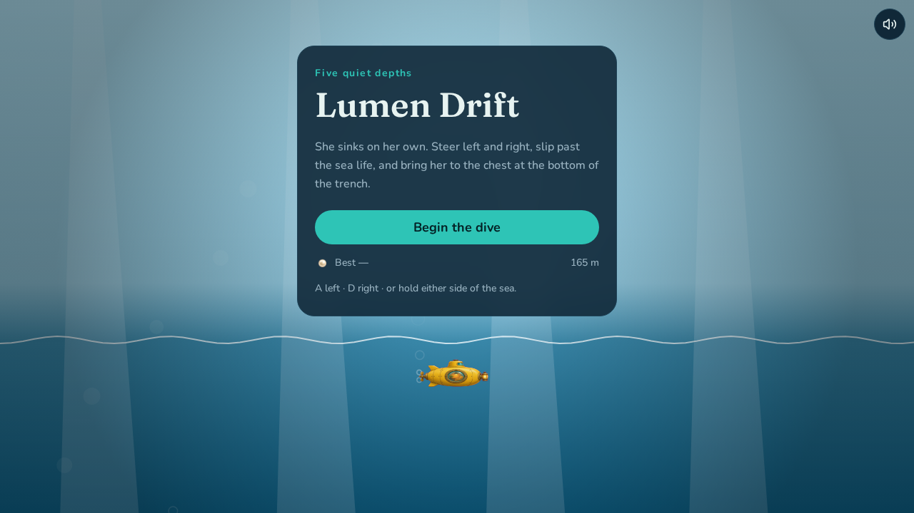

# Lumen Drift

A quiet submarine dive. She sinks on her own. You steer left and right, slip past the sea life, and bring her to the chest at the bottom of the trench.

Five depths. No timers. No high-score servers. Your best depth and your best pearl count stay on this device.



## How to play

The sub starts at the surface and drifts downward. You only choose her path across the water.

- Steer with **A / Left** and **D / Right**, or hold either side of the sea on a phone.
- Collect pearls as they drift past. They are the score.
- Touching a mine, fish, jelly, kelp, coral, rock, urchin, angler, or squid costs one hull pip. A bubble shield spends itself instead.
- Lose all three hull pips and a warm current lifts you back to the start of the current depth. The pearls you already gathered stay with you.
- Reach the goal depth and the water changes. Sink onward to the next layer.
- On the last depth the chest appears. Collect it to open it and finish the dive. The chest adds a handful of celebration pearls.

## The depths

| Depth | Name | What lives there |
|---|---|---|
| 1 | Sunlit Shallows | Fish, jellyfish, kelp |
| 2 | Coral Twilight | Coral, jellyfish, urchins, fish |
| 3 | Midnight Drift | Mines, anglerfish, rocks |
| 4 | Vent Abyss | Squid, mines, anglerfish, rocks |
| 5 | Treasure Trench | Rocks, mines, squid, urchins, then the chest |

Each depth is a checkpoint. Failing sends you back to the start of that depth only.

## Power-ups

Bubbles drift in the safe lane. Catch one.

| Bubble | What it does |
|---|---|
| Bubble shield | Absorbs the next hit, then pops |
| Pearl tide | Pearls drift toward the sub for a few seconds |
| Swift ballast | She sinks faster |
| Calm water | She sinks slower, so you have more time to weave |
| Hull patch | Restores one hull pip (only if she is damaged) |

## Controls

| Action | Keys | Touch |
|---|---|---|
| Steer left / right | A / D, or Left / Right | Hold a side of the sea |
| Pause | P or Escape | Pause button |
| Mute | M | Speaker button |
| Begin, sink onward, retry, surface | On-screen buttons | Same |

The game respects **Reduce Motion**: less shake, calmer motion.

## Best scores

Best depth and best pearls are saved in `localStorage` on this browser. There is no account and no leaderboard. Clearing site data clears the record.

## Run it

```bash
npm install
npm run dev
```

The app is a React + TypeScript canvas game on Vite and Tailwind. Game logic lives in `src/game`. Sprite sheets live in `public/game`.

## What is in the box

- `src/game/sim.ts` — sinking, spawning, collisions, rounds, powers
- `src/game/draw.ts` — water, lantern, sprites, particles
- `src/game/GameView.tsx` — canvas loop, HUD, title / pause / win / fail
- `src/game/audio.ts` — quiet drone and small cues
- `src/game/specs.ts` — the five depths and every creature
- `public/game/` — submarine, sea life, mines, chest, and props
